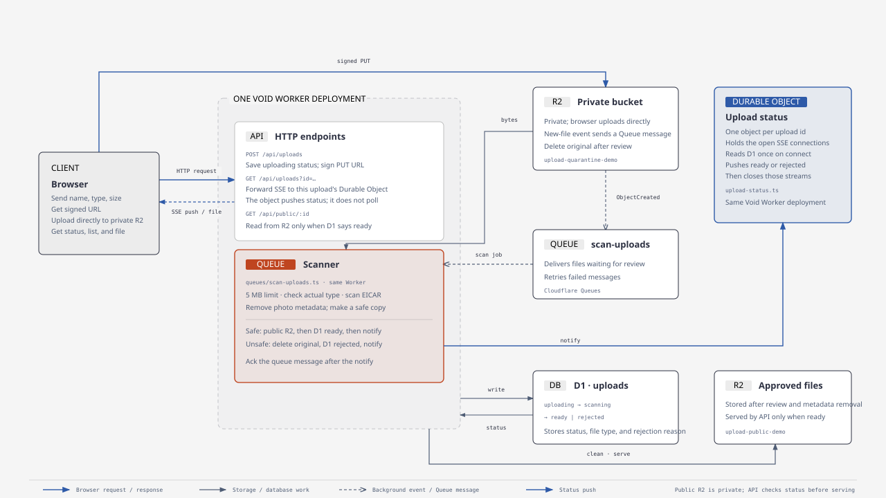
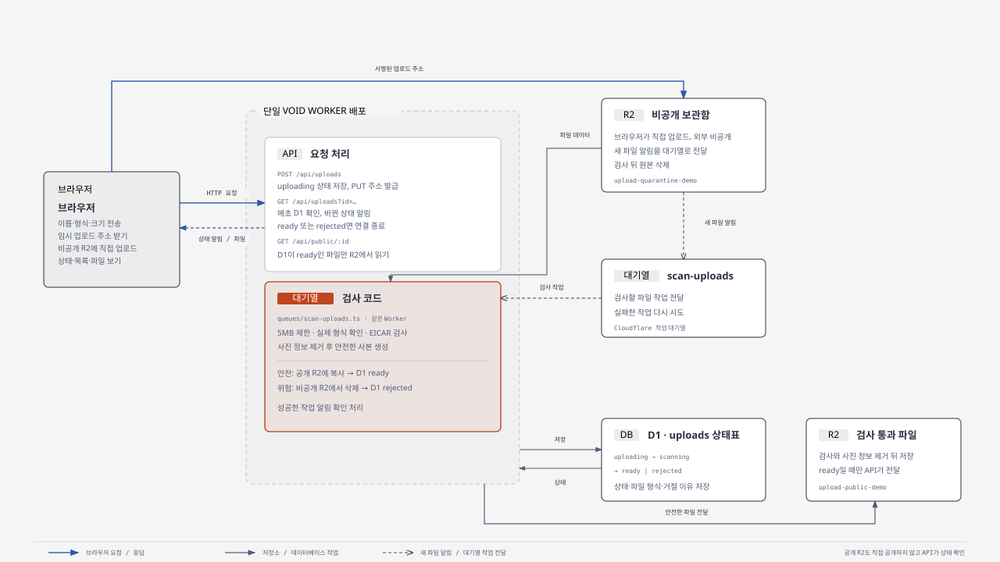

# Image Upload Scanner

A Void example that lets the browser upload images directly to Cloudflare R2, checks them in a private area, and serves only files that pass.

## Why this project has a separate scanner

With a server-mediated upload, the app server receives the file and can inspect it before saving it. With a presigned URL, the browser sends the file straight to storage, so the app server never sees the file bytes during the upload request and cannot inspect them there. A separate scanner must read the stored file and check it before the app makes it available. This project implements that scanner flow.

## How an upload is checked



Open the [full-size diagram](upload-scan-flow.html).

Korean version: [SVG](upload-scan-flow.ko.svg) · [HTML](upload-scan-flow.ko.html).



1. The browser sends the file name, type, and size to the app. The app records the `uploading` status in D1 and returns a temporary URL that can write only to the private bucket.
2. The browser uploads the file directly to the private R2 bucket. No one can view it while it is waiting for review.
3. When a file arrives, R2 sends a message to the `scan-uploads` Queue. Configure this notification in Cloudflare after deployment.
4. The Queue handler receives the message, changes the status to `scanning`, and checks the file. It checks the size and actual file type, looks for the EICAR test string, and removes photo metadata from JPG and PNG files.
5. A safe copy is saved in the public R2 bucket and its status becomes `ready`. A dangerous or invalid file is deleted from the private bucket and its status becomes `rejected`. After either D1 write, the scanner notifies that upload's Durable Object. A retried message does this again if the row is already `ready` or `rejected`, so a crash between the D1 write and the notify still reaches the browser.
6. The browser opens `GET /api/uploads?id=…`. That request is forwarded to one Durable Object named with the upload id (`durable-objects/upload-status.ts`). The object holds the SSE connection. On connect it reads D1 once, which covers the case where the check finished before the browser connected, and sends that status. If the status is already `ready` or `rejected`, it sends the event and closes. Otherwise it waits. When the scanner calls `notify`, the object pushes the event to every connected client (several tabs included) and closes those streams. Nothing in this path reads D1 on a timer. While the stream is open, Void sends a keep-alive comment every 15 seconds. A `scanning` notice that arrives after the final status is ignored. The full upload list is still available from `GET /api/uploads`.
7. Before showing a file, the app checks that its D1 status is `ready`. It then reads the file from the public bucket and sends it to the browser. The public bucket itself is not exposed directly to the internet.

The Queue holds work and delivers it to the handler. The code in `queues/scan-uploads.ts` performs the actual checks. It is deployed with the Worker that handles app requests.

## Run locally

You need [Bun](https://bun.sh/). Download the project and start it with:

```sh
git clone https://github.com/room-777/malfunction-image-scanner.git
cd malfunction-image-scanner
bun install
cp docs/.env.example .env
bun run dev
```

The required values and where to find them are listed in `docs/.env.example`. You can leave the R2 keys blank for local development. In that mode the browser `PUT`s to the app, which stores the file in the local private bucket and sends the same queue message an R2 notification would. The Durable Object runs inside the local worker as well. Upload `fixtures/eicar-infected.png` to see the demo checker reject a file.

`void.lock.json` contains account-specific Cloudflare details, so it is not included in the repository. Run `void connect` and deploy to create your own connection details.

To check the project, run:

```sh
bun run check:file-scan
bun run check
bun run build
```

## Deploy to Cloudflare

1. You need a Cloudflare account. In `void.config.ts`, choose names for the app and buckets. Each name must be unique in your account.
2. Connect to Cloudflare and create the required resources:

   ```sh
   bunx void connect --platform cloudflare
   bunx void deploy --platform cloudflare
   ```

   The same deploy creates the upload-status Durable Object. Void reads `durable-objects/upload-status.ts`, adds the `UPLOAD_STATUS` binding, and records a SQLite class migration. There is no separate dashboard step and no hand-written Wrangler config. `void.lock.json` stores that migration on your machine; this repository leaves the lock file untracked. If you keep a lock file, do not delete or reorder migration entries that have already been deployed.

3. In the private bucket settings, allow your app's address to upload files. Allow `PUT` and `Content-Type`, and keep the bucket private.
4. In [R2 event notifications](https://developers.cloudflare.com/r2/buckets/event-notifications/), send new-file events from the private bucket to the `scan-uploads` Queue. With Wrangler, run:

   ```sh
   bunx wrangler r2 bucket notification create upload-quarantine-demo \
     --event-type object-create --queue scan-uploads --prefix uploads/
   ```

5. Create an [R2 API token](https://developers.cloudflare.com/r2/api/tokens/) for presigned upload URLs. Choose **Object Read & Write** and, if possible, limit it to the private bucket. Enter the values when prompted, then deploy again:

   ```sh
   bunx void secret put R2_ACCOUNT_ID
   bunx void secret put R2_ACCESS_KEY_ID
   bunx void secret put R2_SECRET_ACCESS_KEY
   bunx void deploy --platform cloudflare
   ```

## Required values

`R2_ACCOUNT_ID` is your Cloudflare account ID. `R2_ACCESS_KEY_ID` and `R2_SECRET_ACCESS_KEY` are shown when you create the R2 token. See [`docs/.env.example`](docs/.env.example) for the list. These values can stay blank locally. For deployment, add them with the `void secret put` commands above.

## Improvements for a production setup

Right now, one Worker handles both app requests and Queue messages. To manage CPU limits, deployments, or logs separately, create a second Worker and use it as the Queue consumer.

This project demonstrates the storage and review flow. It is not a real antivirus and only rejects the EICAR test string. A production service should connect a real file-scanning service and add sign-in, upload-size limits, and a retention policy.

## License

Released under the MIT License. See [LICENSE](LICENSE).
